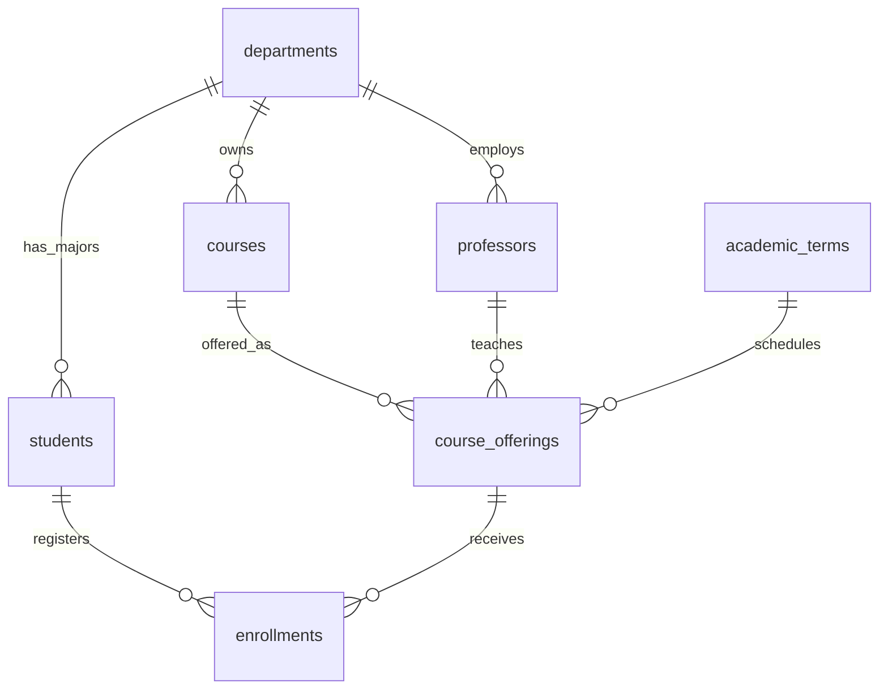

# University Management Database

[](https://github.com/nechypak/University-Management-System-Database/actions/workflows/database.yml)

A PostgreSQL portfolio project exploring relational design, data integrity, migrations, and university analytics. The database separates the course catalog from teaching assignments and term-specific sections, so one course can be offered repeatedly without duplicating its definition.

**Start here:** [schema decisions](docs/database-design.md) · [SQL examples](queries) · [GitHub learning workflow](docs/github-workflow.md) · [next milestones](docs/roadmap.md)

## Data model



The demo contains **10 departments, 45 professors, 60 students, 50 catalog courses, 50 offerings, and 320 enrollments**. Data is synthetic; dates and course titles are illustrative rather than a realistic academic history. The original diagram is retained in [the historical image](UMS_ED_Diagram.png); the diagram above describes the current model.

## Run locally

Requirements: Docker with Compose v2 supporting `--wait`, and Make. Start your Docker engine first.

```sh
git clone https://github.com/nechypak/University-Management-System-Database.git
cd University-Management-System-Database
make setup
make test
make shell
```

`make setup` is for a **new database**. It starts PostgreSQL 16, applies migrations, and loads the demo data. Run it once: the seed intentionally rejects loading over existing data. A failed seed rolls back its inserts; it does not reset the database.

```sh
make migrate  # apply pending schema changes; safe to repeat
make queries  # execute all four analytical examples
make down     # stop the container; keep the database volume
```

The database binds to `127.0.0.1:5433`: database `university_db`, user `university`, password `university_local`. These credentials are only for this local demo. In pgAdmin, connect with these settings and open files from `queries/`.

Without Docker, use an empty PostgreSQL database and the `psql` client:

```sh
psql -X -v ON_ERROR_STOP=1 -d university_db -f schema.sql
psql -X -v ON_ERROR_STOP=1 -d university_db -f tests/integrity.sql
psql -X -v ON_ERROR_STOP=1 -d university_db -f tests/upgrade.sql
```

`schema.sql` now uses psql include commands, so run bootstrap and migration files through **psql**, not pgAdmin's Query Tool. The analytics files are plain SQL and work in either.

## SQL portfolio

| Question | Concepts | Example |
|---|---|---|
| Who registered outside their major department? | Correlated `EXISTS`, joins | [Outside-major enrollment](queries/01_one_course_outside_of_major_dept.sql) |
| How do departments compare? | CTEs, filtered aggregates, `ROW_NUMBER`, left joins | [Department KPIs](queries/02_department_kpis.sql) |
| How many catalog courses and credits does each department offer? | Aggregation, grouping | [Catalog summary](queries/03_average_credits_and_course_count.sql) |
| Which colleagues have different teaching loads? | Self-join, conditional aggregation | [Professor comparison](queries/04_compare_professors.sql) |

KPI GPA is currently the **unweighted mean of completed enrollment grade points**, not a student's credit-weighted GPA. Professor ranking uses the professor's home department; course statistics use the course's owning department. Teaching load counts offerings. See [query semantics](docs/database-design.md#query-semantics) before interpreting results.

## Integrity and verification

The database rejects orphan references, duplicate registrations within an offering, invalid credit amounts, unsupported terms, and incompatible grade/status combinations. A student may retake the same catalog course in another offering.

`make test` checks expected SQLSTATEs and constraint names, valid enrollment states, retakes, seed counts, migration preservation, and execution of every example query. Tests use transactions and roll back their fixture data. The integrity suite expects the unmodified demo dataset; run it against a dedicated demo database.

GitHub Actions runs the same SQL checks on PostgreSQL **14, 16, and 18**, including a second migration run to check repeatability. A configured matrix is not a claim that every version has already passed: inspect the linked workflow runs for results.

## Repository layout

```text
.github/          CI workflow and issue/PR templates
compose.yaml      Local PostgreSQL service
Makefile          Setup and verification commands
db/migrations/    Ordered schema changes
db/seeds/         Synthetic demonstration data
docs/             Design decisions, migration guide, GitHub workflow, roadmap
queries/          Four runnable analytical queries
tests/            Integrity and legacy upgrade checks
schema.sql        New-demo psql entry point
```

## Existing databases

If you loaded the original repository before migrations existed, follow the [legacy upgrade guide](docs/migrations.md). Do not rerun the old destructive schema file or load the demo seed over your existing database.

## Author

Kanstantsin Nechyparenka · [GitHub](https://github.com/nechypak)
